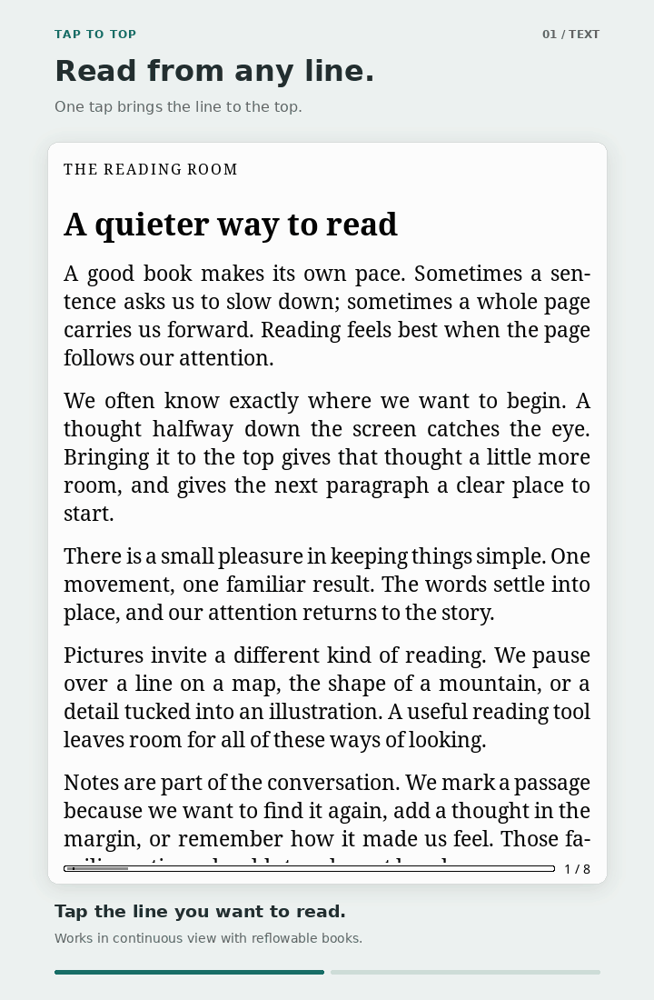
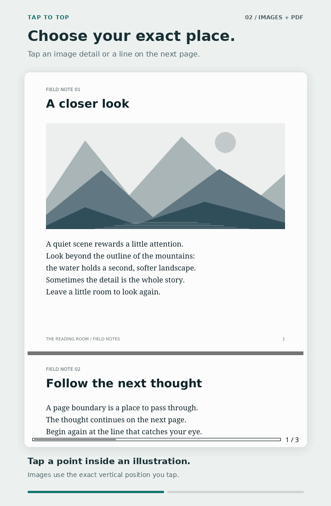
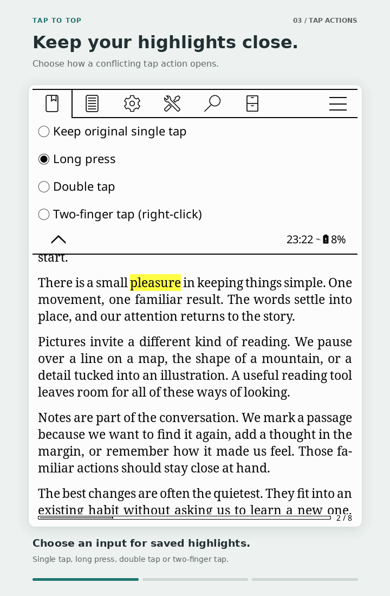
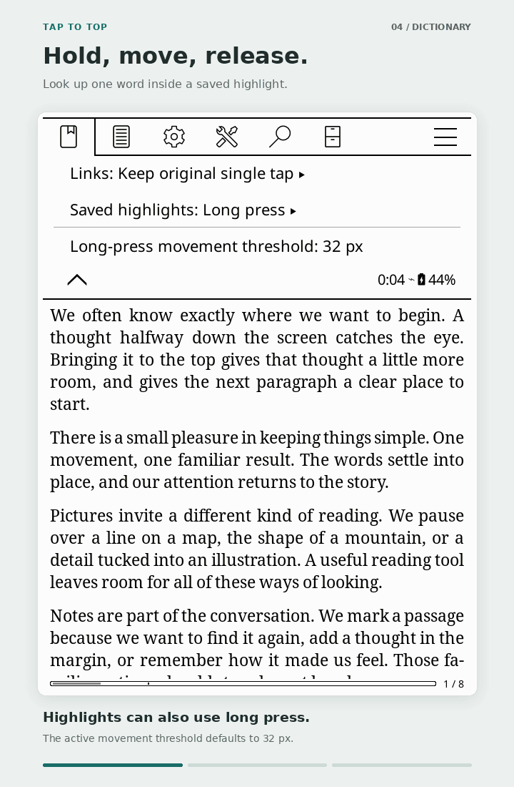

# Tap to top

`tap_to_top.koplugin` moves a tapped text line to the top of the screen in
KOReader's *continuous* View Mode.

<p align="center">
  
</p>

## See it in action

<table>
  <tr>
    <th>Text and paragraphs</th>
    <th>Images and PDFs</th>
  </tr>
  <tr>
    <td width="50%"></td>
    <td width="50%"></td>
  </tr>
  <tr>
    <th>Conflicting tap actions</th>
    <th>Dictionary lookup inside highlights<br>(Activate highlight menu bound to long-press)</th>
  </tr>
  <tr>
    <td width="50%"></td>
    <td width="50%"></td>
  </tr>
</table>

## Behavior and settings

- **Tap on a word/line to align (its page level) to the top of the screen.**
> [!NOTE]
> The plugin is smart enough to detect word/line height boundaries. It doesn't merely scroll pixels at tap position to top. Therefore, you don't have to be highly precise when tapping on line of words and worry if the words will be clipped by the edge of the screen.
>
> Taps on whitespace or images use the exact tap position.
- In the plugin settings: left (20%), right (20%), top (0%), and bottom (0%) margins exempt parts of the screen from the reach of the plugin, so that left/right page turns continue working without being affected by the new tap behaviour.

- Top and bottom menu tap zones keep their normal behavior. Corner tap and long-press zones take priority when an action is assigned,
  unassigned corners remain part of the configured region.
> [!TIP]
> If you find yourself accidentally activating Top or Bottom menus while using tap-to-top frequently on screen positions that happen to collide with KOReader Menu tap zones, a solution is to adjust Menu zone values at:\
> `Top Panel > Tools > More tools > Advance settings`, these keys:
> 
>   <br> 
>  **_MENU** is for *TOP MENU*,&ensp;**_CONFIG** is for *BOTTOM MENU*.&ensp;**_EXT** suffix is for extra/secondary zones of TOP and BOTTOM menus, it is recommended to disable extra/secondary zones by setting its values to 0 for a better plugin experience.
- As both the plugin and open highlighted text menu action use single-tap in screen to activate their functions, a compromise is made which sets double tap to activate highlighted text menu while inside the plugin's active region (screen area left after excluding the aforementioned margins). More about in **Conflicting tap actions** below.
- Both non-reflowable (PDF, DJVU, etc.) and reflowable (EPUB, MOBI, etc.) are supported.

## Conflicting tap actions

### `Top Panel > Settings > Taps and gestures > Scrolling > Tap to top > Conflicting tap actions`

Choose how to open **Links** and **Highlight menu** inside the tap-to-top
active region:

- **Keep original single tap** leaves that action on single tap instead of
  scrolling the tapped link's line to the top.
- **Long press**, **Double tap**, or **Two-finger tap** moves the original action to the selected gesture.

**Links** respects KOReader's native **Tap to follow links** setting. When it
is off, the Links row is faded and inactive, and link locations do not reserve
an input. Turning it back on restores the saved
gesture choice.

<p align="center">
  <strong>Tap-to-top region action binds</strong><br>
  <em>Highlight Menu Activate</em>: Double Tap&emsp; <em>Open Link</em>: Single-tap
</p>

Outside the tap-to-top active region, all reader actions use KOReader's normal behavior. Reader menus, the status
bar, and assigned corner tap zones keep their normal behavior.

On PC, **Two-finger tap (right-click)** also accepts the touchpad's two-finger
tap or a mouse right-click on the link or saved highlight.

Long presses assigned to an action run on release. Dragging starts text
selection when the drag distance reaches **Long-press movement
threshold** hence you can select text even when long press is bound to open link or highlight menu action.
The threshold defaults to **32 px**. Its button is always visible in
**Conflicting tap actions**: faded when no action uses long press, and active
and editable when at least one does.

To look up a single word inside a saved highlight while its menu uses
**Long press**, hold the word, move past the threshold while staying within
that word, and release. The dictionary opens for that word. Dragging across
words selects a passage instead. A stationary long press opens the highlight
menu.

## Tests

Run from the repository directory with LuaJIT:

```sh
luajit tests/test_tap_to_top.lua
luajit tests/test_tap_actions.lua
```

To also check KOReader's actual touch-zone ordering and gesture detection, pass
the `frontend` directory of a KOReader source checkout:

```sh
luajit tests/test_tap_actions.lua /path/to/koreader/frontend
luajit tests/test_gesture_detection.lua /path/to/koreader/frontend
luajit tests/test_gesture_detection.lua /path/to/koreader/frontend desktop
```
